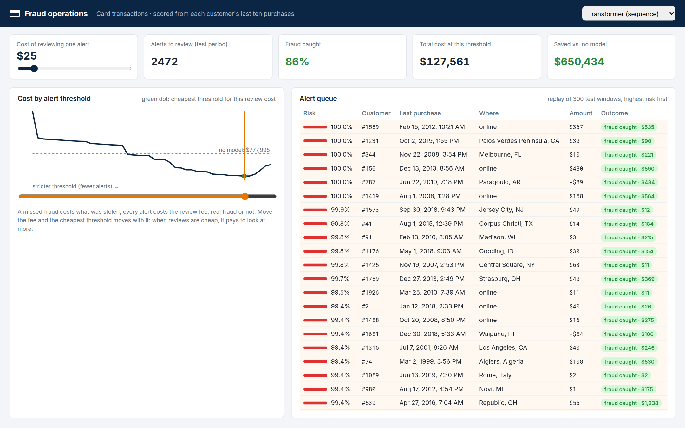

# fraud-sequence-transformer

**Card fraud detection that reads the customer's last ten purchases instead of one, and picks its alert threshold by
money instead of F1.** A reproduction of IBM's TabFormer results, a per-transaction XGBoost baseline, a test of what
happens when the model meets next year's fraud, and a fraud-operations console with a feature store behind it.



## The paper, and what I added

**Tabular Transformers for Modeling Multivariate Time Series** (Padhi et al., IBM, ICASSP 2021,
[arXiv:2011.01843](https://arxiv.org/abs/2011.01843)) released 24 million synthetic card transactions and showed that
modelling a customer's *sequence* of transactions beats looking at them one by one. Their fraud task works on windows
of ten consecutive transactions, which are fraudulent if any of the ten is. Their F1: MLP 0.74, LSTM 0.83, and 0.76 /
0.86 with features from their pretrained TabBERT.

I reproduced the supervised part and added three things:

1. **An industry baseline:** XGBoost on each transaction with history features (amount against the customer's average,
   time since the last purchase, new merchant, new state, purchases in the last 24 hours).
2. **A chronological test:** train on the past, test on what comes after, as the model would be used.
3. **Decisions in money:** calibrated probabilities, and the threshold that minimizes the cost of missed fraud plus
   the cost of reviewing alerts.

## What came out

Test F1, windows of ten transactions ([results/detection](results/detection)):

| model | random split (paper's setup) | chronological split |
|---|---:|---:|
| XGBoost, one transaction at a time | 0.587 | 0.022 (0.073 with 500 trees) |
| MLP over the window (paper: 0.74) | 0.730 | 0.056 |
| LSTM over the window (paper: 0.83) | 0.884 | 0.047 |
| **Transformer over the window** | **0.893** | 0.036 |

**The sequence is the signal.** The MLP lands on the paper's number. The LSTM and a small transformer, both trained
directly on the raw fields with no TabBERT pretraining, reach 0.88–0.89, against 0.59 for the per-transaction model with
hand-made history features. Some fraud only shows as a pattern across purchases.

**And no model survives the calendar.** Trained on 1991–2015 and tested on 2018–2019, every model falls below 0.08. In
this dataset fraud comes in campaigns (3,835 fraudulent transactions in 2010, 55 in 2011, 255 in 2017, 2,491 in 2018),
each with its own pattern, and the last campaign tells you little about the next. The random split hides that by
mixing all years into training. In production this is a retraining and drift-monitoring problem before it is a
modelling one.

**Picking the threshold by money.** Transformer, test set, with isotonic calibration fitted on validation
([results/cost](results/cost)). A missed fraud costs what was stolen; every alert costs a review fee:

| review fee | cost at the best-F1 threshold | cost at the cheapest threshold | no model |
|---|---:|---:|---:|
| $5 | $117,830 | **$74,919** | $777,995 |
| $25 | $155,410 | **$128,286** | $777,995 |
| $100 | $296,335 | $296,335 | $777,995 |

When reviews are cheap it pays to look at more: the cost-optimal threshold catches 86% of fraud instead of 80% and
costs 17–36% less than the F1-optimal one. Calibration matters too: XGBoost's raw scores (trained with class weights)
had an expected calibration error of 0.22, and 0.0001 after isotonic regression.

## How it works

```
24.4M transactions (2,000 customers, 1991-2020)
  -> polars: clean, sort by customer and time, history features (only from earlier transactions)
  -> tokens per field (amount bins, hour, merchant/city/zip hashed, MCC, chip, errors, card)
  -> windows of 10, stride 10: 2.44M windows, 11,492 with fraud
  -> XGBoost per transaction | MLP / LSTM / transformer per window (PyTorch, fraud upsampled 1:4)
  -> isotonic calibration -> cost-optimal threshold
```

- **Prefect** runs the pipeline as a flow (`flows/pipeline.py`), each step a task with retries and timings.
- **Feast** keeps each customer's profile (average amount, last purchase, home state) in a local online store; the API
  reads it to score a new transaction in real time.
- **FastAPI:** `/stream` (a replay of test windows with each model's calibrated risk), `/cost` (cost, recall and alerts
  at every threshold for a review fee), `/score` (a new transaction, scored from its Feast profile).
- **React console:** the review-fee slider, the cost curve, and the alert queue with what each decision catches or
  misses.
- **Jenkins:** lint, tests, web build, the Prefect flow on demand, and a quality gate that fails if the sequence
  models drop below their F1 floor or stop beating the per-transaction baseline.
- **Clean architecture:** `domain/` (windows, metrics, cost) is plain Python, with tests on fakes.

## Run it

```bash
uv sync --group mlops
mkdir -p data/raw && curl -L -o data/raw/transactions.tgz \
  https://media.githubusercontent.com/media/IBM/TabFormer/main/data/credit_card/transactions.tgz
tar -xzf data/raw/transactions.tgz -C data/raw
./run.sh pipeline random     # prepare, features, XGBoost, the three window models, cost (~30 min with a GPU)
./run.sh api                 # http://localhost:8000
./run.sh web                 # http://localhost:5175
./run.sh test
```

## What didn't work, and what doesn't match

- **The paper's count of fraudulent windows.** IBM's code labels a window as fraud if any of its ten transactions is,
  as I do. With a stride of 10 that gives 11,492 fraudulent windows out of 2.44M, not the paper's 29,342. The paper
  also says 20,000 users; the released file has 2,000. My numbers are on the released data, so the task isn't identical
  to the paper's, and an F1 above theirs isn't a claim of beating TabBERT.
- **No TabBERT pretraining.** Masked-field pretraining over 24M rows was more than this one GPU could do in reasonable
  time. The transformer here is trained directly on the fraud labels.
- **Early stopping on the chronological split stopped XGBoost at two trees**, because validation (2016–2017) got worse
  with every tree trained on older years. With 500 trees it's still at 0.07: the model wasn't the problem.
- **Feast serves a profile, not a history.** The real-time endpoint has the customer's average, last purchase and home
  state, but not "new merchant" or "purchases in the last 24 hours", which need the full history; those are set to 0
  there. The offline evaluation uses the full features.
- **Loading the 24M-row token table onto the GPU** while another training was running didn't fit. Gathering each batch
  in RAM and sending only that did.

## Credits and licenses

- Data: IBM TabFormer synthetic credit card transactions ([github.com/IBM/TabFormer](https://github.com/IBM/TabFormer),
  Apache-2.0). Not redistributed here.
- Padhi, Schiff, Melnyk, Rigotti, Mroueh, Dognin, Ross, Nair & Altman, *Tabular Transformers for Modeling Multivariate
  Time Series*, ICASSP 2021.
- Code: MIT.
